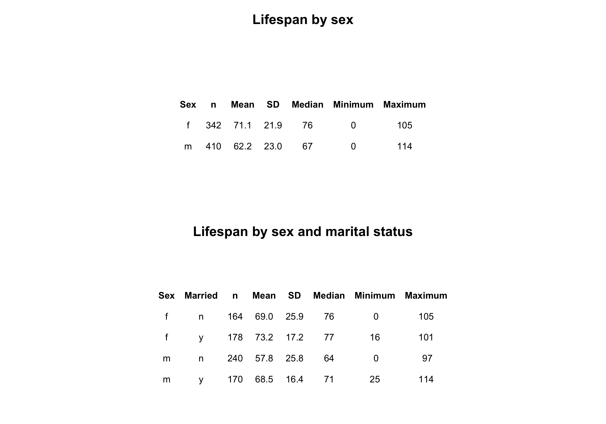
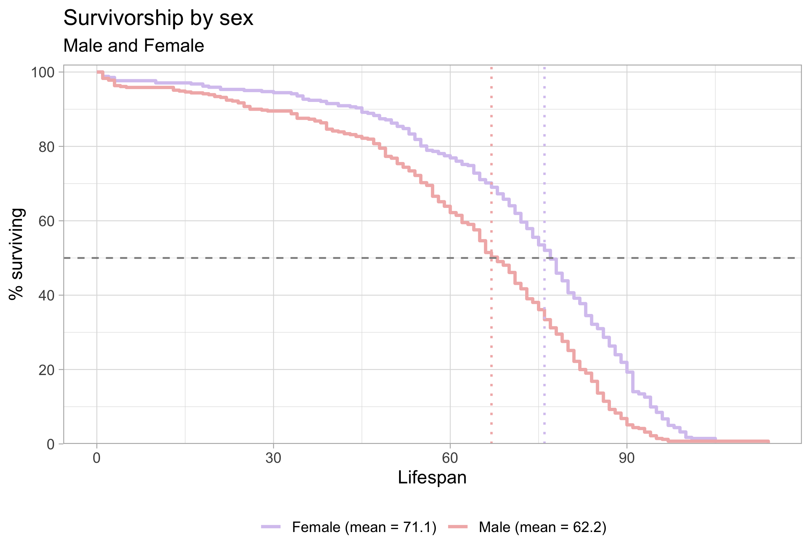
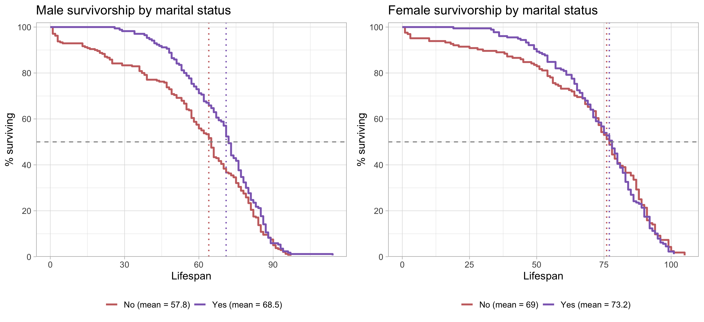

```{=latex}
\onecolumn
\begingroup
\thispagestyle{empty}
\sffamily

% Publication line and journal masthead
\noindent
\begin{minipage}[t]{0.66\linewidth}
  \scriptsize
  Ricks and Arnautovic. \textit{Survivorship Curves of Sunset Hill Cemetery}
  \hfill (2026) 1:1\\
  Valdosta State University, Ecology and Evolution
\end{minipage}
\hfill
\begin{minipage}[t]{0.30\linewidth}
  \raggedleft
  \large Cemetery Demography\\[-2pt]
  \large BIOL 3250
\end{minipage}

\vspace{0.28in}

% Article-type band
\noindent
\colorbox{reportred}{%
  \parbox{\dimexpr\linewidth-2\fboxsep\relax}{%
    \color{white}
    \textbf{RESEARCH ARTICLE}\hfill
    \textbf{CLASS PROJECT}
  }%
}

\vspace{0.18in}

% Title and author line
\noindent
{\fontsize{23}{27}\selectfont
\textbf{Lifespan is Effected by Sex and Marital Status}\par}

\vspace{0.12in}

\noindent
{\small
Brandon Thomas Ricks and Arnautovic\textsuperscript{1,*}
}

\vspace{0.08in}

% Structured abstract
\setlength{\fboxsep}{6pt}
\noindent
\fcolorbox{reportred}{white}{%
  \begin{minipage}{\dimexpr\linewidth-2\fboxsep-2\fboxrule\relax}
    \small

    \textbf{Abstract}

    \vspace{3pt}

    \textbf{Purpose:}
    This project describes lifespan patterns in cemetery records and examines
    variation by sex and marital status. [you can do military service of males or pre- and post- a particular year - default 1930]

    \vspace{3pt}

    \textbf{Methods:}
    Recorded available birth and death information from gravestones
    and classified selected characteristics using evidence visible on the
    stones and in burial arrangements. [Go into much greater detail in the methods section]

    \vspace{3pt}

    \textbf{Results:}
    [Summarize the principal patterns in the class data.]

    \vspace{3pt}

    \textbf{Conclusions:}
    [State what the observed patterns suggest and note limitations. Distinguish
    lifespan in this cemetery sample from population life expectancy.]

    \vspace{3pt}

    \textbf{Keywords:}
    cemetery records; lifespan; survivorship; marital status; historical demography
  \end{minipage}%
}

% Bottom-page author and institutional details
\vfill

\noindent\rule{0.56\linewidth}{0.4pt}

\vspace{3pt}

\noindent
{\scriptsize
\textsuperscript{*}Correspondence: bRicks and Arnautovic@valdosta.edu\\
\textsuperscript{1}Department of Biology, Valdosta State University,
Valdosta, Georgia, USA\\
Ecology and Evolution, BIOL 3250, Section B
}

\vspace{0.10in}

\noindent
\begin{minipage}[c]{0.20\linewidth}
  \includegraphics[width=0.72in]{Valdosta_State_University_seal.png}
\end{minipage}
\endgroup
\twocolumn
```

# Background

Cemetery records provide individual birth and death dates that can be used to describe lifespan among people represented in a burial ground. These records are a non-random sample: cemetery access, preservation of markers, migration, family burial practices, and the choice of graves to record may all affect which people appear in the dataset. The analyses below therefore describe the collected sample and should not be treated as direct estimates of lifespan for an entire town or historical population.

# Hypotheses

Write each hypothesis before interpreting the figures. State the expected direction and identify the comparison.

1. **Sex and lifespan:** I hypothesize that women will have a greater lifespan than men in this sample because of the current events that occured such as war and disease affected the male population .


# Methods
Recorded available birth and death information from gravestones and classified selected characteristics using
evidence visible on the stones and in burial arrangements.

## Field site and sampling

- **Where did you go?** We went to the Sunset Hill cemetery in Valdosta,GA next to the VSU campus on Thursday October 8th. We stayed to the front of the cemetrery and marked names form headstones specifically at the southern eastern edge near the gate. 
- **What date and time of day did you collect records?** We went to collect data on October 8,2026 at 2:30 pm. We left around 3:15pm. The weather was cloudy and humid.
- **What part of the cemetery did you sample?**  I was in the north center section of the cemetery. I mainly stayed in the front of the cemeterey. 
- **How did you choose graves?**  I choose the graves based on readability. If I was able to read the names on the graves clearly without using any interpretation, then I wrote it down for my data. 
- **How did you handle nearby graves and family plots?** If I cam across family plots I would only write down 2-3 names. I would also write down the married couples. 

## Recorded information and variable definitions

- **What information did you record from each marker?** For each marker I wworte down their name, birth year, death year, sex, military indicator, and marriage indicator.  
- **How was lifespan calculated?**  Lifespan was calculated  from death year minus birth year. I only colleceted data from people with full dates. 
- **How did you determine marital status?** I determined marital staus if the headstones were shared and had the same last name. Also if the headstone said married. Some of the gravestones said loving husband or loving wife. 
- **How did you determine military service?**  I determined military because it would say "navy", "World War 2" , "Army", or "Korea" 
- **How did you determine sex or gender?** I determined sex based on name but also who the spouse was. I also made assumptions based on the names. If the name were common to a certain gender. 
- **How were missing, illegible, or ambiguous records handled?**  I did not take in any data that were missing, illegible, or ambiguous. 

## Dataset and analysis

- **How many records were collected by you?**  50 records were collected by my partner and I.
- **How many records were included in the final analysis?** 50 records were included. 
- **Were records aggregated with the class dataset?**  No, records were not aggregated with the class dataset. 
- **What summaries or plots were produced?** Survivorship curves that produced birth period, sex, married by sex, married female, married male,and military males. Those were the categories  used for the plots. 
- **What are the limits of the sample?**  The limits of the sample was confirmation of gender also if people were married or siblings. Many people would have the same last name but we could not tell if the    [Discuss marker preservation, incomplete dates, cemetery selection, sampling strategy, and any other relevant limitations.]

# Results

**Replace each image placeholder with a PNG of the matching plot from the final class dataset. Keep figures in the `survivorship_curves` and `cemetery_lifespan_report_files` folder, or update the image path in the Markdown. The figure captions are editable and should describe the plotted groups, axes, and relevant reference lines.**

**Summarize the data both by referencing @fig-summary and by writing out what the table is displaying specific to your particular research hypothesis. For instance, if you are interested only in marriage status and sex, then report the mean and standard deviation of males and females that are married vs unmarried; you do not need to discuss military status unless this is part of your research question/hypothesis.**

*The summary table in @fig-summary shows substantial differences in recorded lifespan by sex in this sample. Males had a mean lifespan of 59.0 years (SD = 20.4; n = 3), compared with 29.7 years (SD = 7.1; n = 3) for females. The marital-status breakdown is more tentative because each subgroup contains only one or two records. Among males, the two married individuals had a mean lifespan of 70.5 years (SD = 6.4), while the one unmarried individual lived 36 years. Among females, the one married individual lived 36 years, compared with a mean of 26.5 years (SD = 6.4) for the two unmarried individuals. These small subgroup sizes make the values descriptive; they do not support broad conclusions about sex or marital status.*

{#fig-summary width=90% fig-pos="t" fig-env="figure*"}

*The sex-specific survivorship curves in @fig-sex show a different pattern: the plotted means are 61.1 years for males and 57.3 years for females. The male curve remains higher through much of the earlier and middle lifespan, while the female curve reaches the 50% survival point later. The curves are close and change relative position, so the figure suggests that the sex difference depends on which part of the lifespan distribution is considered. The median markers indicate where each group’s observed curve reaches 50% surviving; they are distinct from the mean values shown in the legend.*

{#fig-sex width=70% fig-pos="t" fig-env="figure*"}

*The within-sex comparisons in @fig-married show higher plotted mean lifespans for married than unmarried individuals in both panels. For males, the plotted means are 64.3 years for married individuals and 55.4 years for unmarried individuals. For females, they are 64.3 and 46.3 years, respectively. The curves also place the 50% survival point later for the married groups. These are descriptive differences and should not be interpreted as evidence that marriage caused longer lifespan; other factors and the sizes and composition of the groups could contribute.*

{#fig-married width=70% fig-pos="t" fig-env="figure*"}

**Summary of observed results:** [Describe the main pattern, sample size for each comparison, and any uncertainty or missing-data issue. Refer to the figures by number. Do not infer causation from group differences.]

# Discussion

**Sex and lifespan.** Research on sex differences in longevity points to a combination of biological, behavioral, and social influences rather than a single explanation. Austad and Fischer review evidence on sex differences in lifespan and aging across species, including humans [@austadSexDifferencesLifespan2016]. In this cemetery sample, the observed female and male curves [describe the pattern] and [support / do not support] the prediction that [state your hypothesis]. The result should be interpreted in the context of this cemetery’s birth cohorts and sampling process; it is not by itself an estimate of a general sex difference in lifespan.

**Marital status and social relationships.** Marriage can correlate with social support, health behaviors, household resources, and social integration, but people’s health can also influence whether they marry or remain married. A large meta-analysis found associations between unmarried status and mortality, with some associations differing by sex [@wangSexDifferencesAssociation2020]; a broader meta-analysis linked social relationships with mortality risk [@holt-lunstadSocialRelationshipsMortality2010]. In this dataset, the comparison of married and not-married records among [men / women / both] showed [describe results]. These cemetery records do not measure relationship quality, social contact, or the timing and duration of marriage, so marital status should be treated as an imperfect indicator rather than a direct measure of socialization or a cause of longevity.

**Historical changes in lifespan and childhood survival.** Life expectancy at birth is strongly affected by deaths in infancy and childhood, so a low historical average does not mean that every adult died young. Improvements in clean water and sanitation contributed substantially to mortality declines in the United States during the twentieth century, especially for infants and children [@cutlerRolePublicHealth2005]. The birth-period pattern in this sample [describe results] may be consistent with changing survival conditions, but birth year alone cannot identify which changes mattered. Vaccination, nutrition, medical care, living conditions, and the incomplete representation of people in cemetery records may also contribute to differences across cohorts.

**Limitations and next steps:** [Discuss sample size, missing or inferred data, cemetery representation, family clustering, survivorship bias, and what additional evidence would strengthen the analysis.]

```{=latex}
\newpage
```

### References

::: {#refs} 
::: 
